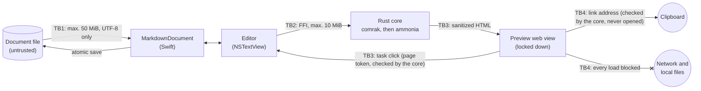

# Threat model

Last updated: 2026-11-21, for v0.1.0-beta.2 (macOS). This document is
updated at every full review (see the [process](README.md)).

## System overview

- **Rust core** (`crates/core`) converts Markdown to HTML with comrak,
  sanitizes it with ammonia and enforces resource limits. It contains no
  `unsafe` code.
- **FFI** (`crates/ffi`) adapts the core to UniFFI. The macOS app links it
  as a static library through generated Swift bindings.
- **macOS app** (`apps/macos`) is a SwiftUI document app. It opens, edits
  and saves Markdown files inside the App Sandbox. The editor is an
  `NSTextView`; the preview is a locked-down web view (`WKWebView`) that
  loads the core's page without content once and then puts the content the
  core rendered into it for every new version of the document. A click on
  a link copies the address the core checked to the clipboard; a click on
  a task checkbox changes one character in the editor, after the core
  checked the page's token.
- **Build and distribution:** GitHub repository, GitHub Actions,
  dependencies from crates.io, Xcode project generated with XcodeGen;
  releases built by the release workflow from signed tags.

## Assets

| Asset | Property to protect |
| --- | --- |
| The user's documents | Integrity (no silent changes or loss), confidentiality |
| Other files on the Mac | Confidentiality and integrity: a document must not read or change them |
| The user's system | No code execution through documents |
| The user's privacy | Opening a document must not reveal anything to third parties |
| Availability of the app | No crash or hang that loses unsaved text |
| Source code, builds and releases | Integrity of what users install |

## Attackers

| Attacker | Capability |
| --- | --- |
| A1: Author of a malicious document | Controls the full content of a file the user opens, for example from email, the web or a repository. The main attacker. |
| A2: Another application on the Mac | Changes or replaces files the app has open. Usually not malicious: sync tools, editors. |
| A3: Supply chain attacker | Compromises a dependency, a GitHub Action or a maintainer account. |
| A4: Malicious contributor | Opens pull requests, including from forks. |

Out of scope: an attacker who already runs code as the user or as root, and
physical access to the Mac.

## Trust boundaries

| Boundary | From (less trusted) | To |
| --- | --- | --- |
| TB1 | Document file | App process (sandboxed) |
| TB2 | Text in Swift | Rust core (through FFI) |
| TB3 | Generated HTML | Preview web view |
| TB4 | Links and images in the document | Network, other apps, local files |
| TB5 | Dependencies, Actions, pull requests | Repository, CI and releases |

## Threats and mitigations (STRIDE)

Status: **in place** (implemented and tested), **planned** (with the
milestone), or **accepted** (see residual risks).

### Spoofing

| ID | Threat | Mitigation | Status |
| --- | --- | --- | --- |
| S1 | The preview imitates app dialogs or hides the real link target | No scripts or forms in the preview; links are never opened; the notice after a click shows the real host without user name or password and the copied address (ASCII only, internationalized host names as Punycode) | in place |
| S2 | A4 or A3 pushes code under a maintainer's identity | Protected `main`, signed commits, required checks, review before merge | in place |

### Tampering

| ID | Threat | Mitigation | Status |
| --- | --- | --- | --- |
| T1 | Opening and saving changes untouched content (encoding, line endings) | Byte-exact round trip, UTF-8 only, byte order mark and line endings preserved; unit and UI tests | in place |
| T2 | A2 changes a file and the app overwrites it silently | System conflict handling for external changes; UI test | in place |
| T3 | A3 injects code through a dependency or Action | `Cargo.lock`, crates.io only (`cargo-deny`), Actions pinned to commit SHAs, 14-day cooldown for new releases, Dependabot | in place |
| T4 | Release artifacts are replaced or modified | Built only by the release workflow from a signed tag (verified by GitHub) on `main` whose CI passed; the build job cannot write to the repository; SHA-256 checksums in the release notes; build provenance and SBOM attestations signed by GitHub (Sigstore); drafts until the maintainer publishes them, immutable afterwards (repository setting) | in place (from v0.1.0-beta.1) |
| T5 | A click in the preview changes the document in an unintended place, or a document triggers such changes itself (task checkboxes) | Each page carries a random token in its task links; a click is applied only with the token of the shown page and only if the text has not changed since that page was rendered; the core changes exactly the one character between the brackets after checking it; protocol-relative links (`//host`), the only way for a document to reach the preview's internal addresses, are removed by the sanitizer; the change goes through the editor and can be undone. Property test: a toggle changes exactly one byte | in place |
| T6 | A document puts misleading or harmful text on the clipboard through a link (hidden characters, line breaks that run a pasted command) | Only the address checked by the core is copied: printable ASCII without spaces, line breaks or invisible characters, at most 4096 bytes; email addresses are decoded only if the result is printable ASCII; the notice shows the real host and the copied text; nothing is copied for blocked links | in place |

### Repudiation

Not relevant for a local single-user app. The repository history is
protected by signed commits.

### Information disclosure

| ID | Threat | Mitigation | Status |
| --- | --- | --- | --- |
| I1 | A document triggers a network request (remote image, font, prefetch) that reveals it was opened | The sanitizer removes remote images; Content Security Policy `default-src 'none'`; a content blocker refuses every load; no navigation; each of policy and content blocker alone blocks a page with dozens of ways to load something (test with a local server). The sandbox allows outgoing connections only because WebKit requires it; CI forbids networking APIs in the app's code and networking crates in the core | in place |
| I2 | A document reads other local files (`file:` URLs, absolute paths, `../`) | The sanitizer allows only relative image paths without scheme or host; App Sandbox; paths resolved and confined to the document folder before loading | in place (sanitizer, sandbox); path confinement planned (local images, v0.2) |
| I3 | Script in the preview reads the document and sends it elsewhere | Raw HTML escaped; allowlist sanitizer without scripts or event handlers; JavaScript of the page disabled; Content Security Policy without script sources; Lockdown Mode | in place |
| I4 | Old document versions keep content the user deleted | Documented system behavior; option to delete versions | planned (v1.0) |
| I5 | Secrets end up in the repository or CI logs | Secret scanning with push protection; CI uses no secrets | in place |

### Denial of service

| ID | Threat | Mitigation | Status |
| --- | --- | --- | --- |
| D1 | Large or pathological documents exhaust CPU or memory | Limits: 50 MiB per file, 10 MiB per render, nesting depth 1000, 1,000,000 syntax tree nodes (which also bounds the preview's memory, SR-2026-005), linear-time escaping. The editor lays out text with TextKit 1 and non-contiguous layout, so long paragraphs stay responsive (SR-2026-004). After its web content process ends, the preview loads its page again at most twice until the document changes, also when the process ends while the content is replaced. Each limit has worst-case tests, the editor a test with a 6 MB paragraph; fuzzing | in place |
| D2 | Deep nesting overflows the stack | Iterative depth check; tests on a 512 KiB stack | in place |
| D3 | An unexpected panic in the core crashes the app and loses unsaved text | `panic = unwind`; UniFFI turns panics into Swift errors | in place |
| D4 | Rendering blocks the user interface | Rendering off the main actor, after a pause in typing; at most one render at a time | in place |

### Elevation of privilege

| ID | Threat | Mitigation | Status |
| --- | --- | --- | --- |
| E1 | Memory corruption in the parser leads to code execution | Safe Rust (`unsafe` forbidden), Swift memory safety; fuzzing | in place |
| E2 | The preview executes code (script, plugins, navigation to `javascript:` URLs) | Sanitizer; JavaScript of the page disabled; Lockdown Mode; every navigation except the app's own page load is cancelled. The app runs one fixed script in an isolated world the page cannot access: it replaces the content of the page's `main` element, and the content is passed as an argument, never as code, so the page's policy applies to it as to loaded content. Tests put hostile markup into the page both ways, loaded and replaced: the policy alone and the content blocker alone each stop every request and script | in place |
| E3 | A link launches a dangerous URL scheme (`file:`, custom app schemes) | Links are never opened, only their address is copied, so no URL is ever handed to another app; CI forbids the APIs for that in the app's code (`NSWorkspace`, Launch Services, `openURL`). The sanitizer allows only `http`, `https`, `mailto` and relative links, and the scheme is checked again after WebKit resolved the link (`link_action` in the core); no system services in the preview's context menu | in place |
| E4 | The app gains more rights than needed | App Sandbox with user-selected file access and outgoing connections (required by WebKit) only; hardened runtime; no debugger attachment in release builds; CI verifies the exact entitlements | in place |
| E5 | A4 compromises CI through a pull request (privileged triggers, script injection) | Pull requests run only with `pull_request` triggers and a read-only token; the release workflow runs only for tags and manual starts, which need write access; permissions per job, no secrets; untrusted values passed through environment variables; workflows audited with zizmor | in place |

## Residual risks

- Vulnerabilities in macOS, WebKit or the Swift and Rust standard libraries
  are outside the project's control. They are mitigated by sandboxing and by
  keeping toolchains current.
- **A click on a link replaces the clipboard.** The copied address may also
  reach the user's other devices through Universal Clipboard and clipboard
  history tools. Accepted: copying is the purpose of the click, and the
  notice says what was copied.
- **Outgoing connections are allowed by the sandbox.** WebKit's network
  process refuses to start for a sandboxed app without this permission, even
  when nothing is loaded from the network, so the preview cannot work
  without it. The app's own code never connects (checked in CI), and the
  preview blocks every load in independent ways. Only an attacker who
  achieves code execution inside WebKit, despite disabled scripts and
  Lockdown Mode, could send data out; without the permission, the operating
  system would stop that as well. Accepted because the alternatives (a
  preview without a web engine, or a separate helper process) would make
  the planned math, diagrams and PDF export impractical.
- **The largest accepted documents need a lot of memory.** A document just
  below the node limit needs about 2.3 GB (1.8 GB in the preview's web
  process, 0.5 GB in the app), and a 50 MB file in a single line about
  2.2 GB and 13 seconds to open. Accepted: both are bounded by the limits,
  the app stays responsive, and lower limits would reject real documents.
- **Releases are ad-hoc signed and not notarized.** macOS asks before the
  first start of a downloaded copy, and the signature does not identify
  the developer. Accepted while the app is for the maintainer's own use:
  the SHA-256 checksums and the attestations signed by GitHub show which
  workflow built the files from which commit. To be reviewed before the
  app is offered to other users.
