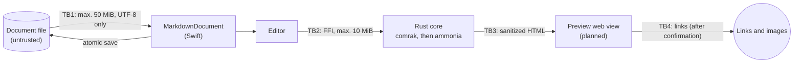

# Threat model

Last updated: 2026-11-13, during development of v0.1 (macOS). This
document is updated at every full review (see the [process](README.md)).

## System overview

- **Rust core** (`crates/core`) converts Markdown to HTML with comrak,
  sanitizes it with ammonia and enforces resource limits. It contains no
  `unsafe` code.
- **FFI** (`crates/ffi`) adapts the core to UniFFI. The macOS app links it
  as a static library through generated Swift bindings.
- **macOS app** (`apps/macos`) is a SwiftUI document app. It opens, edits
  and saves Markdown files inside the App Sandbox. The preview (a web view)
  is planned for v0.1.
- **Build and distribution:** GitHub repository, GitHub Actions,
  dependencies from crates.io, Xcode project generated with XcodeGen,
  release artifacts (planned).

## Assets

| Asset | Property to protect |
| --- | --- |
| The user's documents | Integrity (no silent changes or loss), confidentiality |
| Other files on the Mac | Confidentiality and integrity: a document must not read or change them |
| The user's system | No code execution through documents |
| The user's privacy | Opening a document must not reveal anything to third parties |
| Availability of the app | No crash or hang that loses unsaved text |
| Source code, builds and releases | Integrity of what users install |

## Attackers

| Attacker | Capability |
| --- | --- |
| A1: Author of a malicious document | Controls the full content of a file the user opens, for example from email, the web or a repository. The main attacker. |
| A2: Another application on the Mac | Changes or replaces files the app has open. Usually not malicious: sync tools, editors. |
| A3: Supply chain attacker | Compromises a dependency, a GitHub Action or a maintainer account. |
| A4: Malicious contributor | Opens pull requests, including from forks. |

Out of scope: an attacker who already runs code as the user or as root, and
physical access to the Mac.

## Trust boundaries

| Boundary | From (less trusted) | To |
| --- | --- | --- |
| TB1 | Document file | App process (sandboxed) |
| TB2 | Text in Swift | Rust core (through FFI) |
| TB3 | Generated HTML | Preview web view |
| TB4 | Links and images in the document | Network, other apps, local files |
| TB5 | Dependencies, Actions, pull requests | Repository, CI and releases |

## Threats and mitigations (STRIDE)

Status: **in place** (implemented and tested), **planned** (with the
milestone), or **accepted** (see residual risks).

### Spoofing

| ID | Threat | Mitigation | Status |
| --- | --- | --- | --- |
| S1 | The preview imitates app dialogs or hides the real link target | No scripts or forms in the preview; the link target is shown before it opens | planned (v0.1) |
| S2 | A4 or A3 pushes code under a maintainer's identity | Protected `main`, signed commits, required checks, review before merge | in place |

### Tampering

| ID | Threat | Mitigation | Status |
| --- | --- | --- | --- |
| T1 | Opening and saving changes untouched content (encoding, line endings) | Byte-exact round trip, UTF-8 only, byte order mark and line endings preserved; unit and UI tests | in place |
| T2 | A2 changes a file and the app overwrites it silently | System conflict handling for external changes; UI test | in place |
| T3 | A3 injects code through a dependency or Action | `Cargo.lock`, crates.io only (`cargo-deny`), Actions pinned to commit SHAs, 14-day cooldown for new releases, Dependabot | in place |
| T4 | Release artifacts are replaced or modified | Built from tagged commits; SHA-256 checksums in the release notes | planned (first beta) |

### Repudiation

Not relevant for a local single-user app. The repository history is
protected by signed commits.

### Information disclosure

| ID | Threat | Mitigation | Status |
| --- | --- | --- | --- |
| I1 | A document triggers a network request (remote image, font, prefetch) that reveals it was opened | No network entitlement; the sanitizer removes remote images; strict Content Security Policy in the preview | in place (sanitizer, entitlement); CSP planned (v0.1) |
| I2 | A document reads other local files (`file:` URLs, absolute paths, `../`) | The sanitizer allows only relative image paths without scheme or host; App Sandbox; paths resolved and confined to the document folder before loading | in place (sanitizer, sandbox); path confinement planned (local images, v0.2) |
| I3 | Script in the preview reads the document and sends it elsewhere | Raw HTML escaped; allowlist sanitizer without scripts or event handlers; JavaScript disabled in the preview | in place (core); JavaScript off planned (v0.1) |
| I4 | Old document versions keep content the user deleted | Documented system behavior; option to delete versions | planned (v1.0) |
| I5 | Secrets end up in the repository or CI logs | Secret scanning with push protection; CI uses no secrets | in place |

### Denial of service

| ID | Threat | Mitigation | Status |
| --- | --- | --- | --- |
| D1 | Large or pathological documents exhaust CPU or memory | Limits: 50 MiB per file, 10 MiB per render, nesting depth 1000, 2,000,000 syntax tree nodes, linear-time escaping. Each limit has worst-case tests; fuzzing | in place |
| D2 | Deep nesting overflows the stack | Iterative depth check; tests on a 512 KiB stack | in place |
| D3 | An unexpected panic in the core crashes the app and loses unsaved text | `panic = unwind`; UniFFI turns panics into Swift errors | in place |
| D4 | Rendering blocks the user interface | Rendering off the main actor; at most one render at a time | in place (off main actor); single render planned (v0.1) |

### Elevation of privilege

| ID | Threat | Mitigation | Status |
| --- | --- | --- | --- |
| E1 | Memory corruption in the parser leads to code execution | Safe Rust (`unsafe` forbidden), Swift memory safety; fuzzing | in place |
| E2 | The preview executes code (script, plugins, navigation to `javascript:` URLs) | Sanitizer; JavaScript disabled; no navigation inside the preview | in place (sanitizer); preview settings planned (v0.1) |
| E3 | A link launches a dangerous URL scheme (`file:`, custom app schemes) | Only `http`, `https` and `mailto`; confirmation before opening | in place (sanitizer); confirmation planned (v0.1) |
| E4 | The app gains more rights than needed | App Sandbox with only user-selected file access; hardened runtime; no debugger attachment in release builds; CI verifies the exact entitlements | in place |
| E5 | A4 compromises CI through a pull request (privileged triggers, script injection) | Only `pull_request` triggers; read-only token; no secrets; untrusted values passed through environment variables | in place |

## Residual risks

- Vulnerabilities in macOS, WebKit or the Swift and Rust standard libraries
  are outside the project's control. They are mitigated by sandboxing and by
  keeping toolchains current.
- Until the preview exists, the sanitizer is the only HTML defense layer
  that is in place. The web view settings add a second layer in v0.1.
